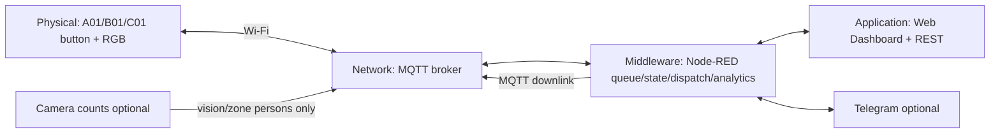

# Máy lấy số / gọi nhân viên hỗ trợ thông minh

**HUIT · Internet of Things · Đề tài 58.** Tạo hàng đợi yêu cầu hỗ trợ tại cửa hàng và đo thời gian phản hồi thực khi nhân viên đến nơi.

Đã kiểm thử:95 unit/runtime/mock tests (gồm 46 vision),6 MQTT scenarios (gồm vision), Dashboard trên Chrome, firmware compile/14 gesture cases và Wokwi browser E2E/offline-reboot. [Kết quả và bằng chứng thật](docs/TEST_RESULTS.md); Telegram live chờ token, hardware thật optional.

Bối cảnh: cửa hàng điện thoại / điện máy khoảng 200 m², khu A — iPhone, B — Android, C — Phụ kiện. Mỗi điểm thực chỉ cần ESP32-C3, một nút và một RGB/WS2812. Node-RED quản lý global queue, dynamic priority, staff dispatch, SLA, adaptive AHT/ETA và forecast staffing. ACK/DONE thuộc Dashboard hoặc Telegram; nhấn nút sau ACK xác nhận **ARRIVED**.

**Camera đếm người (tùy chọn, R18).** Camera chỉ gửi số người theo khu A/B/C qua MQTT, không gửi và không lưu ảnh. Middleware dùng tín hiệu này để tự hủy ticket khi khách bỏ đi, gắn cờ khi REQUEST hoặc ARRIVED không khớp camera, và cảnh báo khách đứng chờ không có ticket. Camera im quá `VISION_STALE_SECONDS` thì các luật tắt và nút bấm chạy như cũ. Demo dùng **webcam laptop** thay cho ESP32-S3; chưa có camera ESP32-S3 thật. Chi tiết và cách chạy publisher: [vision/README.md](vision/README.md).



## Quick Start — PowerShell tại repository root

Cần Node.js ≥22.9 (đã test Node 24.13), npm và Python 3.11+. Không cần Dashboard plugin/CDN. Lịch sử đã có trong repository, tạo lại nếu cần:

```powershell
python analytics/seed_history.py
Set-Location node-red
Copy-Item .env.example .env
npm ci
npm test
npm start
```

Editor: **http://localhost:1880/red** · Dashboard: **http://localhost:1880/** · Health: **http://localhost:1880/api/iot58/health**.

Giữ terminal chạy. Không commit .env; token Telegram rỗng thì DISABLED. Broker mặc định HiveMQ public port 1883 cho Wokwi. Đổi MQTT_BASE_TOPIC và Config::BASE_TOPIC firmware cùng nhau sang namespace riêng trước demo.

Mở project ESP32 trên Wokwi, chép đủ **sketch.ino, diagram.json, libraries.txt và partitions.csv** từ wokwi-demo rồi bấm Play. partitions.csv cần cho LittleFS. Ba nút A/B/C đại diện ba điểm gọi. [Wokwi README](wokwi-demo/README.md) có pin mapping, gesture và compile instructions. Cần lưu project vào tài khoản Wokwi của nhóm để lấy link chia sẻ.

## Local integration test

Wokwi cloud không kết nối trực tiếp localhost. Broker local chỉ dành cho kiểm thử middleware.

```powershell
# Terminal 1, tại root
Set-Location tools
npm ci
npm run broker
```

```powershell
# Terminal 2, tại root: dừng Node-RED public trước
Set-Location node-red
$env:MQTT_HOST = '127.0.0.1'
npm start
```

```powershell
# Terminal 3, tại root
node tools/mqtt_scenario_test.js all
node tools/browser_smoke_test.js controls
node tools/demo_reset.js
```

Không chạy scenario hoặc browser controls song song với Wokwi demo vì các tool reset state. Trở lại public broker: Ctrl+C Node-RED local, `Remove-Item Env:MQTT_HOST` trong terminal đó, kiểm tra .env host public rồi npm start.

[Docker local](docker-compose.local.yml) là tùy chọn: `docker compose -f docker-compose.local.yml up`, cần daemon đang chạy. [Tools README](tools/README.md) hướng dẫn từng scenario và browser QA.

## Demo architecture / V1 vs V2

Trong simulation, một ESP32 được sử dụng để mô phỏng ba logical customer-point nhằm demo hàng đợi trên một project Wokwi. Khi triển khai thật, mỗi điểm gọi là một ESP32-C3 độc lập. OLED/buzzer chung phục vụ demo.

| V1 archive | V2 hiện tại |
|---|---|
| Một local device, chưa global queue | A01/B01/C01 cùng queue server |
| ACK/DONE vật lý | ACK/DONE Dashboard/Telegram |
| SLA cố định, response theo ACK | Configurable SLA, response theo ARRIVED |
| Serial-only, chưa MQTT/Application | MQTT hai chiều, REST và web |
| Timer automation local | Context-aware adaptive decision logic, EWMA và forecast |

V1 và DOCX/PPTX gốc được giữ tại [legacy](legacy/README.md). Tài liệu nghiệm thu hiện hành ở docs; không chạy script V1 để demo V2.

## Tài liệu và bằng chứng

- [Node-RED setup](node-red/README.md), [Dashboard](application/README.md), [REST API](docs/API.md), [MQTT topics](docs/MQTT_TOPICS.md).
- [Contract](docs/IMPLEMENTATION_CONTRACT.md), [Architecture](docs/ARCHITECTURE.md), [Algorithms](docs/ALGORITHMS.md), [Security](docs/SECURITY.md).
- [Demo 5–7 phút](docs/DEMO_SCRIPT_FINAL.md), [Quick demo 3–4 phút](docs/QUICK_DEMO.md), [Evidence checklist](evidence/README.md).
- [Test results](docs/TEST_RESULTS.md), [Acceptance AC01–61](docs/ACCEPTANCE_MATRIX.md), [Vision](vision/README.md), [Rubric traceability](docs/RUBRIC_TRACEABILITY.md), [Deliverables](docs/DELIVERABLE_CHECKLIST.md).
- [Report](docs/REPORT_FINAL.md), [Slides](docs/SLIDES_FINAL_CONTENT.md), [Presentation script](docs/PRESENTATION_SCRIPT_FINAL.md), [Viva Q&A](docs/VIVA_QA.md), [Course mapping](docs/COURSE_OUTLINE_MAPPING.md).

**Dữ liệu lịch sử là dữ liệu giả lập để chứng minh thuật toán, không phải dữ liệu thực tế.** KPI phiên đo event đang chạy. Telegram live cần token/chat ID của nhóm. Wokwi/browser/hardware có trạng thái kiểm chứng riêng trong TEST_RESULTS; không suy PASS simulation từ unit test. Implementation được ánh xạ vào rubric, không bảo đảm 100/100.
