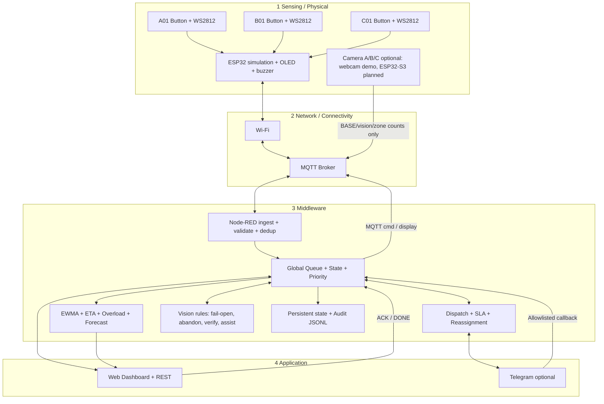
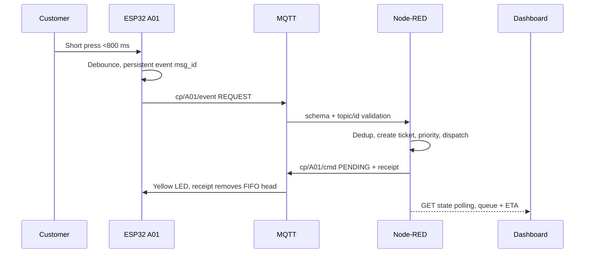
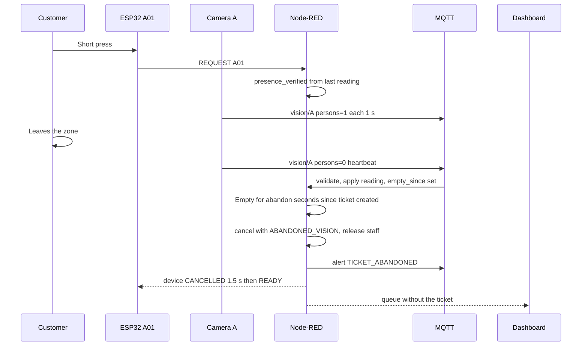
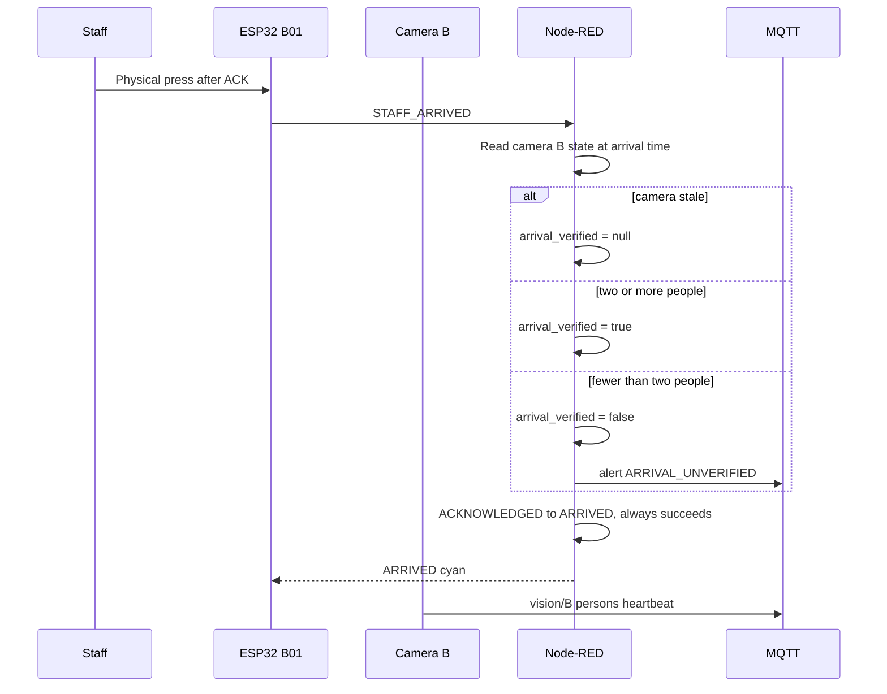
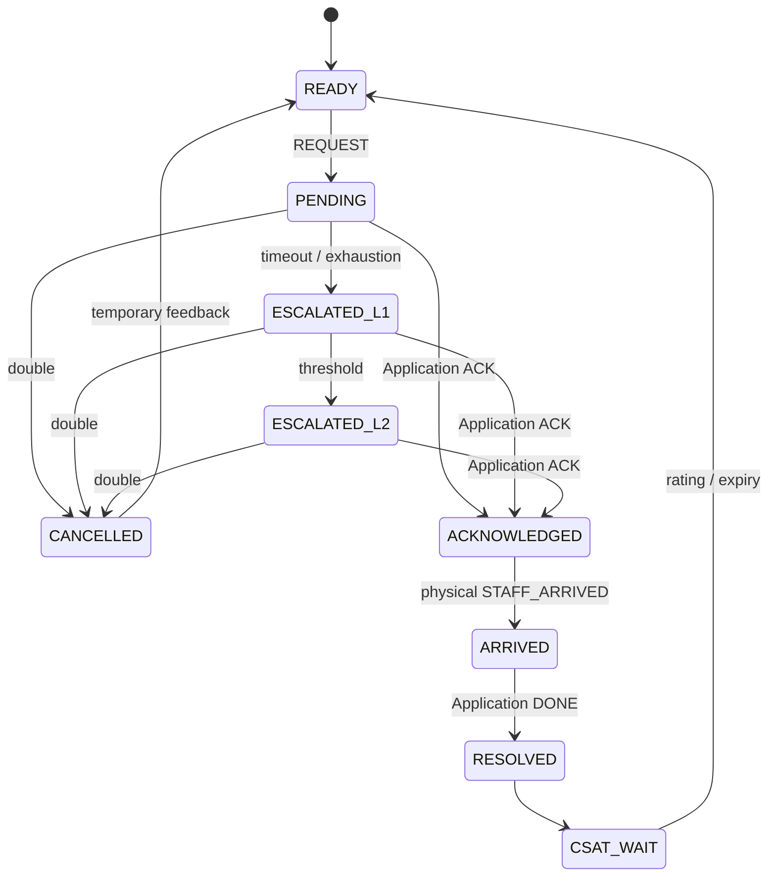

# Kiến trúc bốn tầng

Thiết bị càng đơn giản càng tốt, phần thông minh nằm ở middleware. Trong simulation, một ESP32 được sử dụng để mô phỏng ba logical customer-point nhằm demo hàng đợi trên một project Wokwi. Khi triển khai thật, mỗi điểm gọi là một ESP32-C3 độc lập.



## REQUEST uplink



## ACK downlink

```mermaid
sequenceDiagram
 participant Staff
 participant App as Dashboard / Telegram
 participant NR as Node-RED
 participant MQTT
 participant ESP
 Staff->>App: ACK selected ticket
 App->>NR: POST ack staff_id / allowlisted callback
 NR->>NR: Validate state + staff availability
 NR->>MQTT: cp/B01/cmd ACKNOWLEDGED
 MQTT->>ESP: BLUE + acknowledgement tone
 ESP->>MQTT: CMD_APPLIED cmd_id
 MQTT->>NR: Audit command applied
 NR->>MQTT: Transient receipt, same cmd_id
 MQTT->>ESP: Remove CMD_APPLIED from FIFO; no new command
```

## ARRIVED và DONE

```mermaid
sequenceDiagram
 participant Staff
 participant Customer
 participant ESP
 participant NR as Node-RED
 participant App
 Staff->>ESP: Physical press after ACK
 ESP->>NR: MQTT STAFF_ARRIVED
 NR->>NR: ACKNOWLEDGED → ARRIVED
 NR->>NR: response = arrived_at - created_at
 NR-->>ESP: cmd ARRIVED (cyan)
 Staff->>App: DONE
 App->>NR: POST done
 NR->>NR: ARRIVED → RESOLVED; service; EWMA
 NR-->>ESP: RESOLVED / CSAT window green
 Customer->>ESP: Short/long rating
 ESP->>NR: CSAT satisfied/unsatisfied
 NR-->>ESP: READY; or timeout 15s
```

## SLA escalation

```mermaid
sequenceDiagram
 participant Clock as Real clock scanner
 participant NR as Dispatch engine
 participant S1 as First staff
 participant S2 as Next staff
 participant Group
 participant Manager
 Clock->>NR: ACK timeout (demo 8s / normal 30s)
 NR->>S1: Release reservation; attempt recorded
 NR->>S2: Reassign eligible untried staff
 Clock->>NR: No ACK / exhausted attempts
 NR->>Group: ESCALATED_L1
 Clock->>NR: L2 waiting threshold
 NR->>Manager: ESCALATED_L2
 NR-->>NR: Priority +40; MQTT red fast blink
```

## Vision: khách bỏ đi

Chỉ áp dụng khi `VISION_ENABLED=true` và camera đang tươi. Nếu camera im quá `VISION_STALE_SECONDS`, luật không chạy và ticket giữ nguyên.



## Vision: xác minh nhân viên đến

Camera không chặn ARRIVED. Kết quả chỉ được gắn cờ trên ticket và alert.



Camera chỉ có số người, không có ảnh. Demo hiện tại dùng webcam laptop qua `vision/publisher.py`; hướng ESP32-S3 nằm trong [HARDWARE_BONUS](HARDWARE_BONUS.md).

## State machine



READY và CSAT_WAIT là device state, còn PENDING→RESOLVED/CANCELLED là ticket state. State diagram kết hợp hai lớp để minh họa hành trình khách. Ticket RESOLVED được giữ làm lịch sử ngay cả khi device đã về READY.

Offline và spam lock là overlay của thiết bị, không tự hủy ticket trên server. Node-RED gọi cùng module CommonJS đã được unit test qua functionGlobalContext; static Dashboard tại `/`, editor tại `/red`.

Context localfilesystem là lớp persistence của Node-RED. Runtime còn ghi atomic snapshot để recovery không đợi context flush, và append audit tại `events.jsonl`. Synthetic history chỉ dùng forecast; KPI Dashboard dùng ticket thực của phiên.

Firmware giữ outgoing FIFO trong LittleFS. Browser Wokwi cần upload `partitions.csv` cùng sketch, diagram và libraries; default partition của Wokwi không đủ bảo đảm LittleFS hoạt động.

SLA/aging dùng clock thực của runtime; virtual clock 1×/10×/60× chỉ điều khiển forecast. Response SLA KPI mặc định 120s, cấu hình riêng với assignment ACK timeout và escalation thresholds.

Tham khảo triển khai: [Node-RED runtime configuration](https://nodered.org/docs/user-guide/runtime/configuration), [persistent context](https://nodered.org/docs/user-guide/context), [Wokwi NeoPixel pins](https://docs.wokwi.com/parts/wokwi-neopixel), [Telegram HTTP API](https://core.telegram.org/bots/api).
